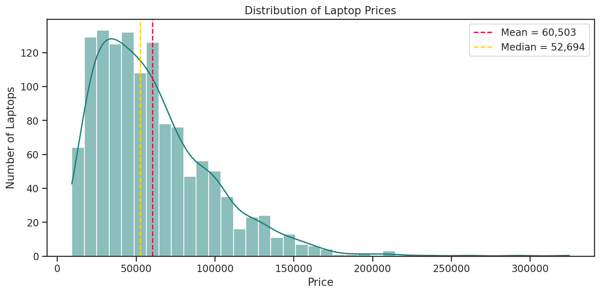
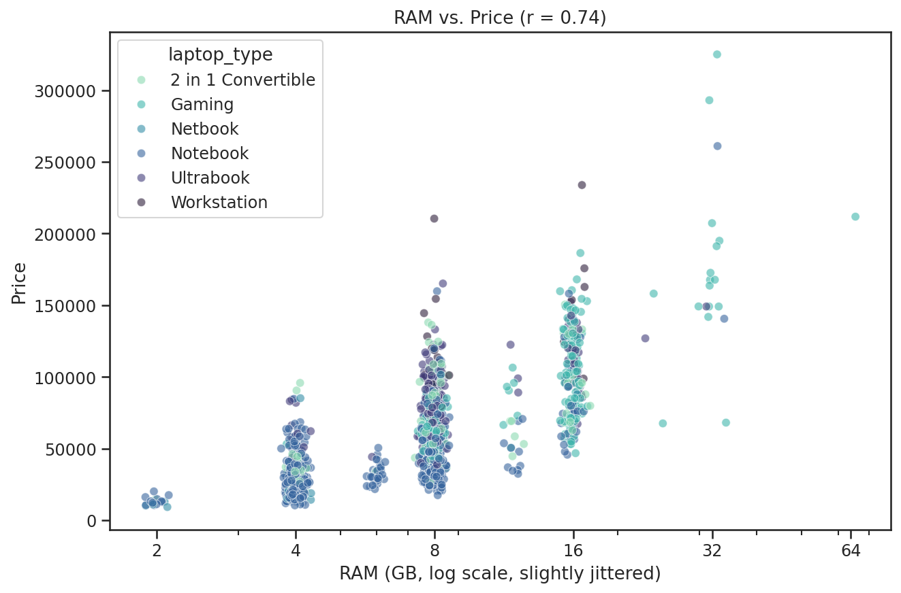
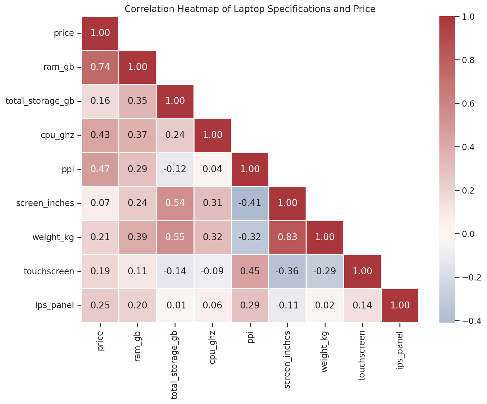

# Laptop Price & Specification Analysis

**Devixo Solutions – AI/ML Internship Program | Task 01: Python Programming, Data Analysis & Visualization**

**Author:** Rafay  |  **Domain:** AI/ML

## Project Objective
Take a raw, real-world dataset through a complete data-analysis pipeline (loading, cleaning, EDA, statistical analysis, visualization and insight generation) to find out which specifications drive laptop prices.

## Dataset Description
Laptop listings with brand, type (Notebook, Gaming, Ultrabook, 2 in 1 Convertible, Workstation, Netbook), screen size and resolution, processor, RAM, storage, graphics card, operating system, weight and price. Most specification columns are stored as text with units (e.g. `8GB`, `1.37kg`, `128GB SSD + 1TB HDD`), so the project includes converting them into numeric features. The dataset has no date column.

| | Rows | Columns |
|---|---|---|
| Raw | 1,303 | 12 |
| Cleaned | 1,274 | 19 |

## Dataset Source
Kaggle – *Laptop Price* dataset (`laptop_data.csv`). The notebook loads a copy of the same file from a public GitHub repository, and asks for a manual upload if the download fails.

## Technologies Used
Python 3, Google Colab / Jupyter Notebook, Streamlit (bonus dashboard), GitHub.

## Libraries Used
Pandas, NumPy, Matplotlib, Seaborn, Plotly (dashboard only), Streamlit, pyngrok (to run the dashboard from Colab).

## Project Workflow
Dataset Selection → Data Loading → Data Understanding → Data Cleaning → Exploratory Data Analysis → Statistical Analysis → Data Visualization → Insights & Findings → Conclusion → Documentation → GitHub

**Cleaning summary (logged in the notebook):**
- No missing values or hidden placeholders were found, so nothing was filled or removed for that reason
- Removed the leftover `Unnamed: 0` index column
- Removed 29 exact duplicate rows
- Converted text columns to numbers: `ram_gb`, `weight_kg`, `total_storage_gb`, `storage_type`, resolution width/height, `ppi`, `cpu_ghz`, `cpu_family`, `gpu_brand`, touchscreen and IPS flags
- Merged `Mac OS X` and `macOS`, renamed columns, checked invalid values (none found)

## Major Findings
- **RAM is the strongest price driver** (r = +0.74); average price rises from about 30,700 (4 GB) to 63,100 (8 GB) to 103,400 (16 GB).
- **Screen size barely affects price** (r = +0.07), even though it is strongly linked to weight (+0.83).
- **Core i7** laptops average about 85,900 vs 54,100 (Core i5) and 28,900 (Core i3); Nvidia-GPU laptops average 79,700 vs 54,400 (Intel) and 41,500 (AMD).
- **Workstations** and **Gaming** laptops are the priciest types; among larger brands **MSI** is the most expensive and **Acer** the cheapest.
- SSD-only laptops average about 2x the price of HDD-only laptops.

## Visualizations
11 charts are in the `images/` folder, for example:





## Project Structure
```
Task_01_AI_ML/
├── dataset/        laptop_data.csv, laptop_data_cleaned.csv
├── notebook/       Task_01_Data_Analysis_Rafay.ipynb
├── images/         visualization_01.png ... visualization_11.png
├── report/         Task_01_Report.pdf
├── app/            app.py  (Streamlit dashboard)
└── README.md
```

## How to Run the Project
1. Open `notebook/Task_01_Data_Analysis_Rafay.ipynb` in Google Colab (upload it, or use "Open in Colab" from GitHub).
2. Click **Runtime → Run all**. The dataset downloads automatically; if it fails, upload `laptop_data.csv` when asked.
3. *(Optional dashboard)* Paste your own free ngrok authtoken into the `NGROK_TOKEN` line in the bonus cell, run it, and open the printed link (click **Visit Site** on the ngrok warning page).

To run the dashboard locally instead:
```bash
pip install streamlit plotly pandas
streamlit run app/app.py
```

## Student / Author
**Rafay** – AI/ML Intern, Devixo Solutions
